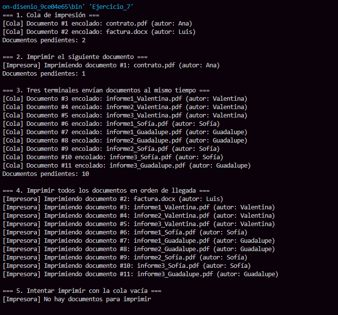

# Unidad 2
------Ejercicio 1: Configuración Inicial de la Aplicación-----
Problema
Una aplicación modular necesita cargar sus propiedades de configuración desde un archivo maestro cuando arranca. Si cada componente creara su propio lector de configuración:

Se leería el archivo varias veces y esto sigfnifica que se desperdician recursos de entrada/salida.
Podrían quedar valores distintos en memoria según el componente.
Solución: patrón Singleton

La clase ConfigurationManager se restringe para que exista una sola instancia en toda la aplicación, y cualquier parte del programa puede acceder a ella.

¿Que hace el código?
-Carga el archivo de configuración una sola vez.
-Dos componentes (ComponenteBaseDatos y ComponenteCorreo) consultan parámetros sin crear su propio lector.
-Comprueba que dos referencias distintas apuntan al mismo objeto.
-Llama otra vez a cargar() y verifica que se ignora.
-Consulta una clave que no existe, con y sin valor por defecto.
-Crea 10 hilos y comprueba que todos obtienen la misma instancia.
-Recuerda que el constructor privado impide crear objetos desde afuera.

Lo que muestra en consola:

------Ejercicio 2: Gestor de Conexiones a Base de Datos Simple-----
Problema:
Abrir y cerrar conexiones a una base de datos todo el tiempo hace que el sistema vaya más lento. Se necesita un gestor central que controle el acceso a los datos y que use siempre la misma conexión.

Solución:
Se usa el patrón Singleton en la clase GestorConexion: existe un único gestor y una única conexión. Como no hay una base de datos real, la conexión y las operaciones se simulan con mensajes por pantalla.

Qué hace el programa
-Abre la conexión.
-Dos módulos (clientes y productos) hacen una consulta y una actualización con la misma conexión.
-Compara dos referencias con == para comprobar que es el mismo objeto.
-Intenta abrir la conexión otra vez y comprueba que se usa la misma.
-Muestra el estado, cierra la conexión y comprueba que un módulo ya no puede consultar.

Explicación de la clase:
+instancia: atributo estático que guarda el único gestor. Empieza en null.
+conectada: indica si la conexión está abierta (true) o cerrada (false).
+Constructor privado: impide crear objetos con new desde otras clases.
+obtenerInstancia(): crea el gestor la primera vez y después devuelve siempre el mismo.
+abrirConexion() y cerrarConexion(): cambian el estado de la conexión.
+ejecutarConsulta() y ejecutarActualizacion(): simulan una operación; si la conexión está cerrada, avisan que no se puede.
+getEstado(): devuelve CONECTADA o CERRADA.
+ModuloClientes y ModuloProductos: piden el gestor con obtenerInstancia() y lo usan, pero nunca lo crean.

Lo que muestra en consola:

------Ejercicio 3: Registro de Eventos (Logger) Básico-----

Problema:

Toda aplicación necesita registrar eventos, advertencias y errores en un archivo de texto. Si cada clase abriera su propio flujo de escritura hacia el mismo archivo, podrían producirse bloqueos y datos corruptos.

Solución:

Se usa el patrón Singleton en la clase Logger: existe un único logger y todos los mensajes pasan por él. Cada mensaje se muestra por consola y se guarda en el archivo registro.log, con la fecha y hora agregadas automáticamente.

Qué hace el programa:

- Borra el archivo anterior para empezar limpio y registra un mensaje INFO desde el main.
- Dos módulos (usuarios y pagos) registran mensajes en el mismo logger: INFO, WARNING (pago muy alto) y ERROR (monto inválido).
- Compara dos referencias con == para comprobar que es el mismo objeto.
- Lee el archivo registro.log y lo muestra por pantalla, para comprobar que se guardó todo.

Explicación de la clase:

+ instancia: atributo estático que guarda el único logger. Empieza en null.
+ archivoLog: nombre del archivo donde se guardan los mensajes (registro.log).
+ Constructor privado: impide crear objetos con new desde otras clases.
+ obtenerInstancia(): crea el logger la primera vez y después devuelve siempre el mismo.
+ info(), warning() y error(): son los métodos públicos que usan los demás módulos. Cada uno llama a registrar() con su nivel (INFO, WARNING o ERROR).
+ registrar(): arma la línea con la fecha y hora, el nivel y el mensaje, la muestra por consola y la agrega al final del archivo. Es synchronized para que dos hilos no escriban al mismo tiempo.
+ ModuloUsuarios y ModuloPagos: piden el logger con obtenerInstancia() y lo usan, pero nunca lo crean.
Lo que muestra en consola: 

------Ejercicio 4: Servicio de Caché en Memoria-----

Problema:

Una plataforma web consulta muchas veces los mismos perfiles de usuario. Para no pedirlos al servidor cada vez, se guardan en una caché en memoria. Como la memoria es limitada, toda la aplicación debe compartir una única caché.

Solución:

Se usa el patrón Singleton en la clase CacheServicio: existe una única caché y todos los módulos la comparten. Los datos se guardan en un HashMap privado, con una clave única para cada elemento. La caché se crea recién cuando se pide por primera vez con obtenerInstancia().

Qué hace el programa:

- Muestra que la caché no existe hasta que se la pide por primera vez.
- Un módulo (perfiles) guarda dos perfiles en la caché y se comprueba que no se puede guardar una clave repetida.
- Otro módulo (sesiones) recupera los perfiles de la misma caché y avisa cuando un usuario no está.
- Verifica si una clave existe y actualiza datos (solo si la clave ya existe).
- Elimina un elemento y muestra la cantidad que queda.
- Compara dos referencias con == para comprobar que es el mismo objeto y muestra el contenido final.

Explicación de la clase:

+ instancia: atributo estático que guarda la única caché. Empieza en null, por eso se crea solo cuando se la pide (inicialización diferida).
+ datos: HashMap privado donde se guardan los elementos. Como es private y no hay ningún método que lo devuelva, nadie de afuera puede modificarlo directamente.
+ Constructor privado: impide crear objetos con new desde otras clases.
+ obtenerInstancia(): crea la caché la primera vez y después devuelve siempre la misma.
+ guardar(): agrega un elemento nuevo. Si la clave ya existe, avisa y no lo pisa.
+ obtener(): devuelve el valor de una clave, o null si no existe.
+ actualizar(): cambia el valor de una clave, pero solo si ya existe.
+ eliminar(): borra un elemento, verificando antes que exista.
+ existe(): indica si una clave está en la caché.
+ claveValida(): validación interna que no deja guardar claves nulas o vacías.
+ synchronized: los métodos están sincronizados para que dos hilos no modifiquen la caché al mismo tiempo.
+ ModuloPerfiles y ModuloSesiones: piden la caché con obtenerInstancia() y la usan, pero nunca la crean.

Lo que muestra en consola:

------Ejercicio 5: Administrador de Dispositivos de Hardware Únicos-----

Problema:

En un sistema de automatización industrial, el software se comunica con un único puerto serial conectado a un dispositivo robótico. Si dos componentes envían comandos al mismo tiempo a ese puerto, pueden producirse fallas graves en el hardware.

Solución:

Se usa el patrón Singleton en la clase ControladorHardware: existe un único controlador y todos los módulos del sistema usan ese mismo objeto para hablar con el dispositivo. Como no hay un hardware real, el puerto y los comandos se simulan con mensajes por pantalla. Antes de enviar un comando se valida que el dispositivo esté disponible.

Qué hace el programa:

- Obtiene el controlador y muestra su estado inicial (DESCONECTADO).
- Intenta enviar un comando con el dispositivo desconectado y comprueba que no se envía.
- Conecta el dispositivo y el estado pasa a LISTO.
- El módulo del brazo robótico envía un comando y el dispositivo queda OCUPADO.
- El módulo de la cinta intenta enviar otro comando mientras el dispositivo está ocupado y no se le permite.
- Cuando el comando termina, el dispositivo queda libre y la cinta puede enviar el suyo.
- Compara dos referencias con == para comprobar que es el mismo objeto y muestra cuántos comandos se enviaron.

Explicación de la clase:

+ instancia: atributo estático que guarda el único controlador. Empieza en null.
+ final: la clase es final para que nadie pueda heredar de ella y crear otra versión del controlador.
+ Constructor privado: impide crear objetos con new desde otras clases, por eso no se puede duplicar el controlador.
+ obtenerInstancia(): crea el controlador la primera vez y después devuelve siempre la misma referencia a todos los módulos.
+ conectado y ocupado: indican si el dispositivo está conectado y si está ejecutando un comando.
+ conectar() y desconectar(): cambian el estado de la conexión.
+ estaDisponible(): valida que el dispositivo esté conectado y no esté ocupado.
+ enviarComando(): simula el envío de un comando, pero solo si el dispositivo está disponible. Devuelve true si se envió y false si no.
+ finalizarComando(): simula que el dispositivo terminó y queda libre para el siguiente comando.
+ leerEstado(): devuelve el estado actual: DESCONECTADO, LISTO u OCUPADO.
+ synchronized: los métodos están sincronizados para que dos hilos no manejen el dispositivo al mismo tiempo.
+ ModuloBrazoRobotico y ModuloCinta: piden el controlador con obtenerInstancia(), validan con estaDisponible() y recién ahí envían el comando.

Lo que muestra en consola: 

------Ejercicio 5: Administrador de Dispositivos de Hardware Únicos-----

Problema:

En un sistema de automatización industrial, el software se comunica con un único puerto serial conectado a un dispositivo robótico. Si dos componentes envían comandos al mismo tiempo a ese puerto, pueden producirse fallas graves en el hardware.

Solución:

Se usa el patrón Singleton en la clase ControladorHardware: existe un único controlador y todos los módulos del sistema usan ese mismo objeto para hablar con el dispositivo. Como no hay un hardware real, el puerto y los comandos se simulan con mensajes por pantalla. Antes de enviar un comando se valida que el dispositivo esté disponible.

Qué hace el programa:

- Obtiene el controlador y muestra su estado inicial (DESCONECTADO).
- Intenta enviar un comando con el dispositivo desconectado y comprueba que no se envía.
- Conecta el dispositivo y el estado pasa a LISTO.
- El módulo del brazo robótico envía un comando y el dispositivo queda OCUPADO.
- El módulo de la cinta intenta enviar otro comando mientras el dispositivo está ocupado y no se le permite.
- Cuando el comando termina, el dispositivo queda libre y la cinta puede enviar el suyo.
- Compara dos referencias con == para comprobar que es el mismo objeto y muestra cuántos comandos se enviaron.

Explicación de la clase:

+ instancia: atributo estático que guarda el único controlador. Empieza en null.
+ final: la clase es final para que nadie pueda heredar de ella y crear otra versión del controlador.
+ Constructor privado: impide crear objetos con new desde otras clases, por eso no se puede duplicar el controlador.
+ obtenerInstancia(): crea el controlador la primera vez y después devuelve siempre la misma referencia a todos los módulos.
+ conectado y ocupado: indican si el dispositivo está conectado y si está ejecutando un comando.
+ conectar() y desconectar(): cambian el estado de la conexión.
+ estaDisponible(): valida que el dispositivo esté conectado y no esté ocupado.
+ enviarComando(): simula el envío de un comando, pero solo si el dispositivo está disponible. Devuelve true si se envió y false si no.
+ finalizarComando(): simula que el dispositivo terminó y queda libre para el siguiente comando.
+ leerEstado(): devuelve el estado actual: DESCONECTADO, LISTO u OCUPADO.
+ synchronized: los métodos están sincronizados para que dos hilos no manejen el dispositivo al mismo tiempo.
+ ModuloBrazoRobotico y ModuloCinta: piden el controlador con obtenerInstancia(), validan con estaDisponible() y recién ahí envían el comando.

Lo que muestra en consola: 
------Ejercicio 6: Gestor de Temas y Apariencia Visual-----

Problema:

Una aplicación permite cambiar entre el tema claro y el tema oscuro. Todas las vistas de la aplicación tienen que mostrar los mismos colores y actualizarse cuando el usuario cambia la preferencia.

Solución:

Se usa el patrón Singleton en la clase GestorTemas: existe un único gestor que guarda el tema actual y sus colores. Todas las vistas le piden los datos a ese mismo objeto, por eso el estado visual no se divide entre vistas y cuando el usuario cambia el tema, todas muestran los colores nuevos.

Qué hace el programa:

- Muestra el tema inicial (Claro) y los colores que usa cada vista.
- Desde la vista de Configuración se cambia a tema Oscuro y se comprueba que las tres vistas muestran los colores nuevos.
- Alterna entre claro y oscuro con alternarTema().
- Intenta poner un tema que no existe (Azul) y comprueba que no se acepta.
- Compara dos referencias con == para comprobar que es el mismo objeto y muestra cuántos cambios de tema se hicieron.

Explicación de la clase:

+ instancia: atributo estático que guarda el único gestor. Empieza en null.
+ temaActual, colorFondo y colorTexto: atributos privados que guardan el estado visual. No se pueden modificar desde afuera.
+ Constructor privado: impide crear objetos con new desde otras clases. Al crearse deja el tema en Claro.
+ obtenerInstancia(): crea el gestor la primera vez y después devuelve siempre el mismo.
+ cambiarTema(): cambia el tema, pero solo acepta "Claro" u "Oscuro". Cualquier otro valor se rechaza.
+ alternarTema(): pasa de claro a oscuro, o de oscuro a claro.
+ getTemaActual(), getColorFondo() y getColorTexto(): permiten consultar el estado desde cualquier vista.
+ aplicarColores(): método privado y único lugar donde se modifican los colores, por eso solo se pueden cambiar con métodos controlados de la clase.
+ synchronized: los métodos están sincronizados para que dos hilos no cambien el tema al mismo tiempo.
+ VistaPrincipal, VistaPerfil y VistaConfiguracion: piden el gestor con obtenerInstancia() y consultan los colores, pero nunca lo crean.

Lo que muestra en consola: 

------Ejercicio 7: Cola de Impresión Centralizada-----

Problema:

Una oficina comparte una impresora de red. Varias terminales envían documentos al mismo tiempo y el sistema tiene que imprimirlos en el orden en que llegaron, sin perder documentos y sin imprimir ninguno dos veces.

Solución:

Se usa el patrón Singleton en la clase ColaImpresion: existe una única cola de impresión y todas las terminales envían sus documentos a ese mismo objeto. La cola (una Queue de tipo LinkedList) está dentro de la clase y solo se puede modificar con los métodos encolar() e imprimirSiguiente(), que son synchronized para evitar problemas cuando varios hilos trabajan a la vez. Como no hay una impresora real, la impresión se simula con mensajes por pantalla.

Qué hace el programa:

- Encola dos documentos con su nombre de archivo y su autor.
- Imprime el siguiente documento y comprueba que sale el primero que llegó (FIFO) y que se elimina de la cola.
- Tres terminales (hilos) envían tres documentos cada una al mismo tiempo, y se comprueba que todos entran a la cola con un número correlativo.
- Imprime todos los documentos pendientes en orden de llegada.
- Intenta imprimir con la cola vacía y muestra un aviso.
- Compara dos referencias con == para comprobar que es el mismo objeto y verifica que la cantidad de documentos encolados es igual a la de impresos (no se perdió ninguno).

Explicación de la clase:

+ instancia: atributo estático que guarda la única cola de impresión. Empieza en null.
+ cola: Queue privada donde se guardan los documentos. Funciona como una fila: el primero que entra es el primero que sale.
+ Constructor privado: impide crear objetos con new desde otras clases, por eso no puede haber dos colas.
+ obtenerInstancia(): crea la cola de impresión la primera vez y después devuelve siempre la misma.
+ Documento: clase con los datos de cada trabajo (número, nombre del archivo y autor).
+ encolar(): le asigna un número al documento y lo agrega al final de la cola.
+ imprimirSiguiente(): saca el primer documento de la cola con poll(), simula la impresión y lo elimina. Si la cola está vacía, avisa.
+ imprimirTodos(): repite imprimirSiguiente() hasta que la cola queda vacía.
+ getCantidadPendientes(), getTotalEncolados() y getTotalImpresos(): permiten consultar los contadores.
+ synchronized: evita las condiciones de carrera. Solo un hilo a la vez puede entrar a encolar() o imprimirSiguiente(), así no se pierden ni se duplican documentos y los números salen en orden.
+ Terminal: clase que extiende Thread y simula una terminal de usuario que envía varios documentos. Pide la cola con obtenerInstancia() y nunca la crea.

Lo que muestra en consola:

## Bloque B: ejercicios 11 a 20

| N.º | Ejercicio | Patrón | Estado |
|---|---|---|---|
| 11 | _pendiente_ | | ⏳ |
| 12 | _pendiente_ | | ⏳ |
| 13 | _pendiente_ | | ⏳ |
| 14 | _pendiente_ | | ⏳ |
| 15 | _pendiente_ | | ⏳ |
| 16 | _pendiente_ | | ⏳ |
| 17 | _pendiente_ | | ⏳ |
| 18 | _pendiente_ | | ⏳ |
| 19 | _pendiente_ | | ⏳ |
| 20 | _pendiente_ | | ⏳ |

[← Volver al índice general](../README.md)
