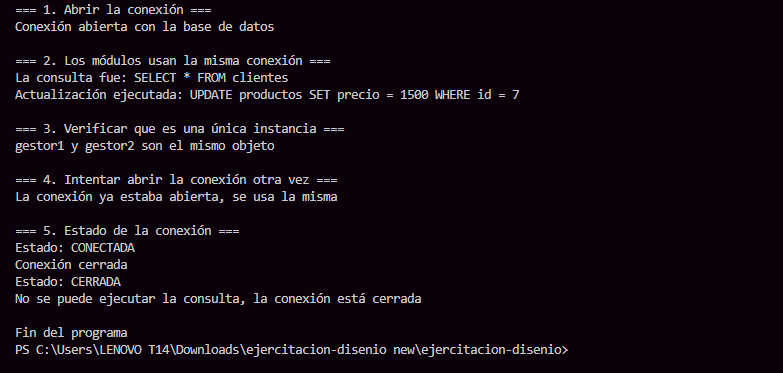
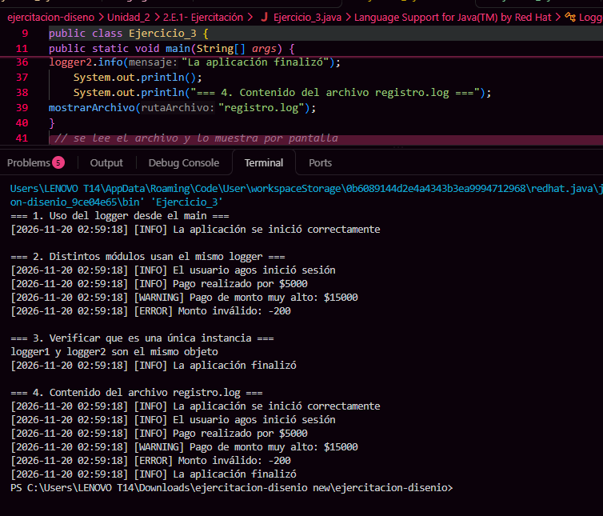
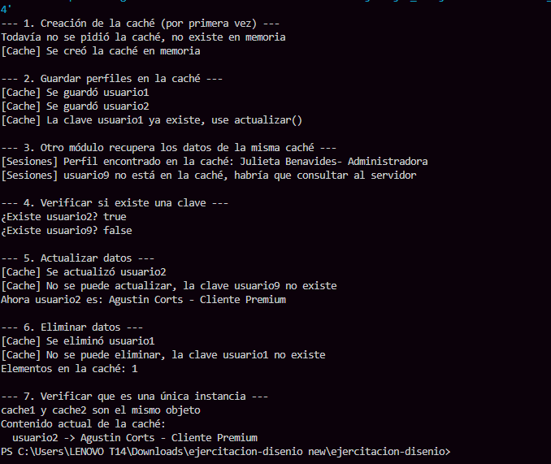
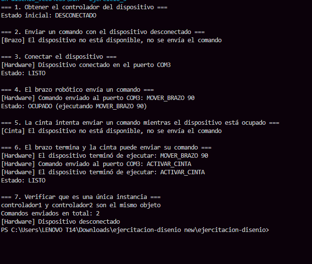
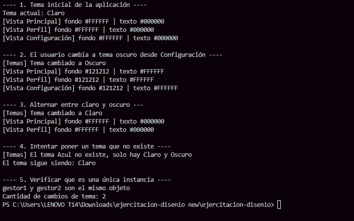
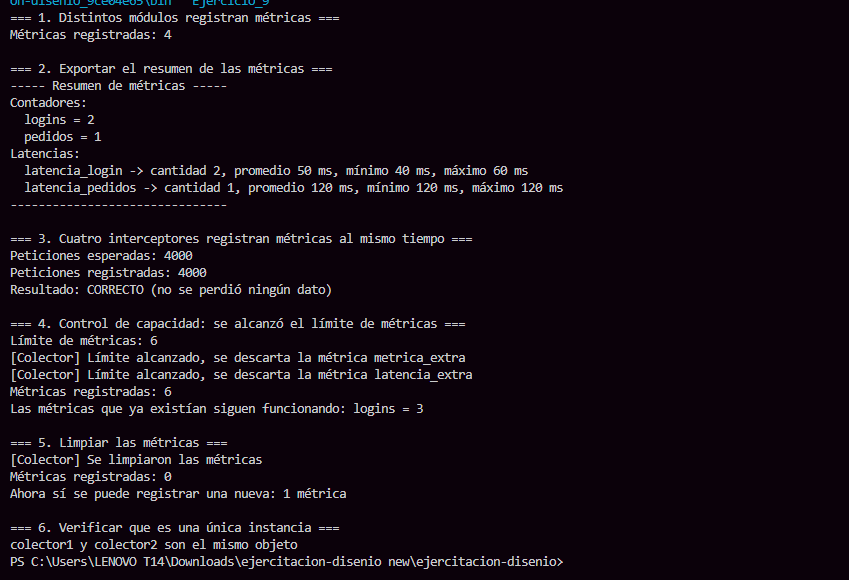
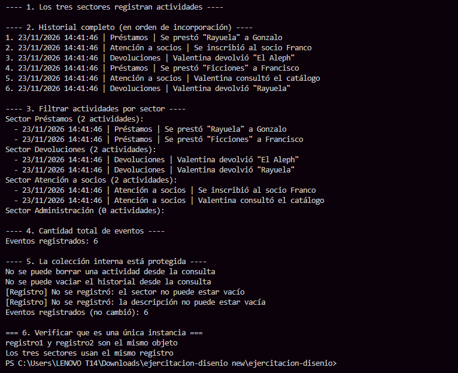
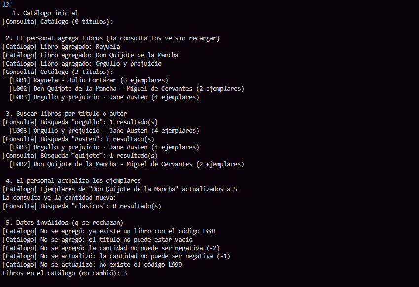

# Ejercitacion 2.E.1 : Ejercicio del 1 al 10
------Ejercicio 1: Configuración Inicial de la Aplicación-----
Problema
Una aplicación modular necesita cargar sus propiedades de configuración desde un archivo maestro cuando arranca. Si cada componente creara su propio lector de configuración:

Se leería el archivo varias veces y esto sigfnifica que se desperdician recursos de entrada/salida.
Podrían quedar valores distintos en memoria según el componente.
Solución: patrón Singleton

La clase ConfigurationManager se restringe para que exista una sola instancia en toda la aplicación, y cualquier parte del programa puede acceder a ella.

¿Que hace el código?
-Carga el archivo de configuración una sola vez.
-Dos componentes (ComponenteBaseDatos y ComponenteCorreo) consultan parámetros sin crear su propio lector.
-Comprueba que dos referencias distintas apuntan al mismo objeto.
-Llama otra vez a cargar() y verifica que se ignora.
-Consulta una clave que no existe, con y sin valor por defecto.
-Crea 10 hilos y comprueba que todos obtienen la misma instancia.
-Recuerda que el constructor privado impide crear objetos desde afuera.

Lo que muestra en consola:

------Ejercicio 2: Gestor de Conexiones a Base de Datos Simple-----
Problema:
Abrir y cerrar conexiones a una base de datos todo el tiempo hace que el sistema vaya más lento. Se necesita un gestor central que controle el acceso a los datos y que use siempre la misma conexión.

Solución:
Se usa el patrón Singleton en la clase GestorConexion: existe un único gestor y una única conexión. Como no hay una base de datos real, la conexión y las operaciones se simulan con mensajes por pantalla.

Qué hace el programa
-Abre la conexión.
-Dos módulos (clientes y productos) hacen una consulta y una actualización con la misma conexión.
-Compara dos referencias con == para comprobar que es el mismo objeto.
-Intenta abrir la conexión otra vez y comprueba que se usa la misma.
-Muestra el estado, cierra la conexión y comprueba que un módulo ya no puede consultar.

Explicación de la clase:
+instancia: atributo estático que guarda el único gestor. Empieza en null.
+conectada: indica si la conexión está abierta (true) o cerrada (false).
+Constructor privado: impide crear objetos con new desde otras clases.
+obtenerInstancia(): crea el gestor la primera vez y después devuelve siempre el mismo.
+abrirConexion() y cerrarConexion(): cambian el estado de la conexión.
+ejecutarConsulta() y ejecutarActualizacion(): simulan una operación; si la conexión está cerrada, avisan que no se puede.
+getEstado(): devuelve CONECTADA o CERRADA.
+ModuloClientes y ModuloProductos: piden el gestor con obtenerInstancia() y lo usan, pero nunca lo crean.

Lo que muestra en consola:

------Ejercicio 3: Registro de Eventos (Logger) Básico-----

Problema:

Toda aplicación necesita registrar eventos, advertencias y errores en un archivo de texto. Si cada clase abriera su propio flujo de escritura hacia el mismo archivo, podrían producirse bloqueos y datos corruptos.

Solución:

Se usa el patrón Singleton en la clase Logger: existe un único logger y todos los mensajes pasan por él. Cada mensaje se muestra por consola y se guarda en el archivo registro.log, con la fecha y hora agregadas automáticamente.

Qué hace el programa:

- Borra el archivo anterior para empezar limpio y registra un mensaje INFO desde el main.
- Dos módulos (usuarios y pagos) registran mensajes en el mismo logger: INFO, WARNING (pago muy alto) y ERROR (monto inválido).
- Compara dos referencias con == para comprobar que es el mismo objeto.
- Lee el archivo registro.log y lo muestra por pantalla, para comprobar que se guardó todo.

Explicación de la clase:

+ instancia: atributo estático que guarda el único logger. Empieza en null.
+ archivoLog: nombre del archivo donde se guardan los mensajes (registro.log).
+ Constructor privado: impide crear objetos con new desde otras clases.
+ obtenerInstancia(): crea el logger la primera vez y después devuelve siempre el mismo.
+ info(), warning() y error(): son los métodos públicos que usan los demás módulos. Cada uno llama a registrar() con su nivel (INFO, WARNING o ERROR).
+ registrar(): arma la línea con la fecha y hora, el nivel y el mensaje, la muestra por consola y la agrega al final del archivo. Es synchronized para que dos hilos no escriban al mismo tiempo.
+ ModuloUsuarios y ModuloPagos: piden el logger con obtenerInstancia() y lo usan, pero nunca lo crean.
Lo que muestra en consola: 

------Ejercicio 4: Servicio de Caché en Memoria-----

Problema:

Una plataforma web consulta muchas veces los mismos perfiles de usuario. Para no pedirlos al servidor cada vez, se guardan en una caché en memoria. Como la memoria es limitada, toda la aplicación debe compartir una única caché.

Solución:

Se usa el patrón Singleton en la clase CacheServicio: existe una única caché y todos los módulos la comparten. Los datos se guardan en un HashMap privado, con una clave única para cada elemento. La caché se crea recién cuando se pide por primera vez con obtenerInstancia().

Qué hace el programa:

- Muestra que la caché no existe hasta que se la pide por primera vez.
- Un módulo (perfiles) guarda dos perfiles en la caché y se comprueba que no se puede guardar una clave repetida.
- Otro módulo (sesiones) recupera los perfiles de la misma caché y avisa cuando un usuario no está.
- Verifica si una clave existe y actualiza datos (solo si la clave ya existe).
- Elimina un elemento y muestra la cantidad que queda.
- Compara dos referencias con == para comprobar que es el mismo objeto y muestra el contenido final.

Explicación de la clase:

+ instancia: atributo estático que guarda la única caché. Empieza en null, por eso se crea solo cuando se la pide (inicialización diferida).
+ datos: HashMap privado donde se guardan los elementos. Como es private y no hay ningún método que lo devuelva, nadie de afuera puede modificarlo directamente.
+ Constructor privado: impide crear objetos con new desde otras clases.
+ obtenerInstancia(): crea la caché la primera vez y después devuelve siempre la misma.
+ guardar(): agrega un elemento nuevo. Si la clave ya existe, avisa y no lo pisa.
+ obtener(): devuelve el valor de una clave, o null si no existe.
+ actualizar(): cambia el valor de una clave, pero solo si ya existe.
+ eliminar(): borra un elemento, verificando antes que exista.
+ existe(): indica si una clave está en la caché.
+ claveValida(): validación interna que no deja guardar claves nulas o vacías.
+ synchronized: los métodos están sincronizados para que dos hilos no modifiquen la caché al mismo tiempo.
+ ModuloPerfiles y ModuloSesiones: piden la caché con obtenerInstancia() y la usan, pero nunca la crean.

Lo que muestra en consola:

------Ejercicio 5: Administrador de Dispositivos de Hardware Únicos-----

Problema:

En un sistema de automatización industrial, el software se comunica con un único puerto serial conectado a un dispositivo robótico. Si dos componentes envían comandos al mismo tiempo a ese puerto, pueden producirse fallas graves en el hardware.

Solución:

Se usa el patrón Singleton en la clase ControladorHardware: existe un único controlador y todos los módulos del sistema usan ese mismo objeto para hablar con el dispositivo. Como no hay un hardware real, el puerto y los comandos se simulan con mensajes por pantalla. Antes de enviar un comando se valida que el dispositivo esté disponible.

Qué hace el programa:

- Obtiene el controlador y muestra su estado inicial (DESCONECTADO).
- Intenta enviar un comando con el dispositivo desconectado y comprueba que no se envía.
- Conecta el dispositivo y el estado pasa a LISTO.
- El módulo del brazo robótico envía un comando y el dispositivo queda OCUPADO.
- El módulo de la cinta intenta enviar otro comando mientras el dispositivo está ocupado y no se le permite.
- Cuando el comando termina, el dispositivo queda libre y la cinta puede enviar el suyo.
- Compara dos referencias con == para comprobar que es el mismo objeto y muestra cuántos comandos se enviaron.

Explicación de la clase:

+ instancia: atributo estático que guarda el único controlador. Empieza en null.
+ final: la clase es final para que nadie pueda heredar de ella y crear otra versión del controlador.
+ Constructor privado: impide crear objetos con new desde otras clases, por eso no se puede duplicar el controlador.
+ obtenerInstancia(): crea el controlador la primera vez y después devuelve siempre la misma referencia a todos los módulos.
+ conectado y ocupado: indican si el dispositivo está conectado y si está ejecutando un comando.
+ conectar() y desconectar(): cambian el estado de la conexión.
+ estaDisponible(): valida que el dispositivo esté conectado y no esté ocupado.
+ enviarComando(): simula el envío de un comando, pero solo si el dispositivo está disponible. Devuelve true si se envió y false si no.
+ finalizarComando(): simula que el dispositivo terminó y queda libre para el siguiente comando.
+ leerEstado(): devuelve el estado actual: DESCONECTADO, LISTO u OCUPADO.
+ synchronized: los métodos están sincronizados para que dos hilos no manejen el dispositivo al mismo tiempo.
+ ModuloBrazoRobotico y ModuloCinta: piden el controlador con obtenerInstancia(), validan con estaDisponible() y recién ahí envían el comando.

Lo que muestra en consola: 

------Ejercicio 5: Administrador de Dispositivos de Hardware Únicos-----

Problema:

En un sistema de automatización industrial, el software se comunica con un único puerto serial conectado a un dispositivo robótico. Si dos componentes envían comandos al mismo tiempo a ese puerto, pueden producirse fallas graves en el hardware.

Solución:

Se usa el patrón Singleton en la clase ControladorHardware: existe un único controlador y todos los módulos del sistema usan ese mismo objeto para hablar con el dispositivo. Como no hay un hardware real, el puerto y los comandos se simulan con mensajes por pantalla. Antes de enviar un comando se valida que el dispositivo esté disponible.

Qué hace el programa:

- Obtiene el controlador y muestra su estado inicial (DESCONECTADO).
- Intenta enviar un comando con el dispositivo desconectado y comprueba que no se envía.
- Conecta el dispositivo y el estado pasa a LISTO.
- El módulo del brazo robótico envía un comando y el dispositivo queda OCUPADO.
- El módulo de la cinta intenta enviar otro comando mientras el dispositivo está ocupado y no se le permite.
- Cuando el comando termina, el dispositivo queda libre y la cinta puede enviar el suyo.
- Compara dos referencias con == para comprobar que es el mismo objeto y muestra cuántos comandos se enviaron.

Explicación de la clase:

+ instancia: atributo estático que guarda el único controlador. Empieza en null.
+ final: la clase es final para que nadie pueda heredar de ella y crear otra versión del controlador.
+ Constructor privado: impide crear objetos con new desde otras clases, por eso no se puede duplicar el controlador.
+ obtenerInstancia(): crea el controlador la primera vez y después devuelve siempre la misma referencia a todos los módulos.
+ conectado y ocupado: indican si el dispositivo está conectado y si está ejecutando un comando.
+ conectar() y desconectar(): cambian el estado de la conexión.
+ estaDisponible(): valida que el dispositivo esté conectado y no esté ocupado.
+ enviarComando(): simula el envío de un comando, pero solo si el dispositivo está disponible. Devuelve true si se envió y false si no.
+ finalizarComando(): simula que el dispositivo terminó y queda libre para el siguiente comando.
+ leerEstado(): devuelve el estado actual: DESCONECTADO, LISTO u OCUPADO.
+ synchronized: los métodos están sincronizados para que dos hilos no manejen el dispositivo al mismo tiempo.
+ ModuloBrazoRobotico y ModuloCinta: piden el controlador con obtenerInstancia(), validan con estaDisponible() y recién ahí envían el comando.

Lo que muestra en consola: 
------Ejercicio 6: Gestor de Temas y Apariencia Visual-----

Problema:

Una aplicación permite cambiar entre el tema claro y el tema oscuro. Todas las vistas de la aplicación tienen que mostrar los mismos colores y actualizarse cuando el usuario cambia la preferencia.

Solución:

Se usa el patrón Singleton en la clase GestorTemas: existe un único gestor que guarda el tema actual y sus colores. Todas las vistas le piden los datos a ese mismo objeto, por eso el estado visual no se divide entre vistas y cuando el usuario cambia el tema, todas muestran los colores nuevos.

Qué hace el programa:

- Muestra el tema inicial (Claro) y los colores que usa cada vista.
- Desde la vista de Configuración se cambia a tema Oscuro y se comprueba que las tres vistas muestran los colores nuevos.
- Alterna entre claro y oscuro con alternarTema().
- Intenta poner un tema que no existe (Azul) y comprueba que no se acepta.
- Compara dos referencias con == para comprobar que es el mismo objeto y muestra cuántos cambios de tema se hicieron.

Explicación de la clase:

+ instancia: atributo estático que guarda el único gestor. Empieza en null.
+ temaActual, colorFondo y colorTexto: atributos privados que guardan el estado visual. No se pueden modificar desde afuera.
+ Constructor privado: impide crear objetos con new desde otras clases. Al crearse deja el tema en Claro.
+ obtenerInstancia(): crea el gestor la primera vez y después devuelve siempre el mismo.
+ cambiarTema(): cambia el tema, pero solo acepta "Claro" u "Oscuro". Cualquier otro valor se rechaza.
+ alternarTema(): pasa de claro a oscuro, o de oscuro a claro.
+ getTemaActual(), getColorFondo() y getColorTexto(): permiten consultar el estado desde cualquier vista.
+ aplicarColores(): método privado y único lugar donde se modifican los colores, por eso solo se pueden cambiar con métodos controlados de la clase.
+ synchronized: los métodos están sincronizados para que dos hilos no cambien el tema al mismo tiempo.
+ VistaPrincipal, VistaPerfil y VistaConfiguracion: piden el gestor con obtenerInstancia() y consultan los colores, pero nunca lo crean.

Lo que muestra en consola: 

------Ejercicio 7: Cola de Impresión Centralizada-----

Problema:

Una oficina comparte una impresora de red. Varias terminales envían documentos al mismo tiempo y el sistema tiene que imprimirlos en el orden en que llegaron, sin perder documentos y sin imprimir ninguno dos veces.

Solución:

Se usa el patrón Singleton en la clase ColaImpresion: existe una única cola de impresión y todas las terminales envían sus documentos a ese mismo objeto. La cola (una Queue de tipo LinkedList) está dentro de la clase y solo se puede modificar con los métodos encolar() e imprimirSiguiente(), que son synchronized para evitar problemas cuando varios hilos trabajan a la vez. Como no hay una impresora real, la impresión se simula con mensajes por pantalla.

Qué hace el programa:

- Encola dos documentos con su nombre de archivo y su autor.
- Imprime el siguiente documento y comprueba que sale el primero que llegó (FIFO) y que se elimina de la cola.
- Tres terminales (hilos) envían tres documentos cada una al mismo tiempo, y se comprueba que todos entran a la cola con un número correlativo.
- Imprime todos los documentos pendientes en orden de llegada.
- Intenta imprimir con la cola vacía y muestra un aviso.
- Compara dos referencias con == para comprobar que es el mismo objeto y verifica que la cantidad de documentos encolados es igual a la de impresos (no se perdió ninguno).

Explicación de la clase:

+ instancia: atributo estático que guarda la única cola de impresión. Empieza en null.
+ cola: Queue privada donde se guardan los documentos. Funciona como una fila: el primero que entra es el primero que sale.
+ Constructor privado: impide crear objetos con new desde otras clases, por eso no puede haber dos colas.
+ obtenerInstancia(): crea la cola de impresión la primera vez y después devuelve siempre la misma.
+ Documento: clase con los datos de cada trabajo (número, nombre del archivo y autor).
+ encolar(): le asigna un número al documento y lo agrega al final de la cola.
+ imprimirSiguiente(): saca el primer documento de la cola con poll(), simula la impresión y lo elimina. Si la cola está vacía, avisa.
+ imprimirTodos(): repite imprimirSiguiente() hasta que la cola queda vacía.
+ getCantidadPendientes(), getTotalEncolados() y getTotalImpresos(): permiten consultar los contadores.
+ synchronized: evita las condiciones de carrera. Solo un hilo a la vez puede entrar a encolar() o imprimirSiguiente(), así no se pierden ni se duplican documentos y los números salen en orden.
+ Terminal: clase que extiende Thread y simula una terminal de usuario que envía varios documentos. Pide la cola con obtenerInstancia() y nunca la crea.

Lo que muestra en consola: 

------Ejercicio 8: Refactorización hacia Inyección de Dependencias-----

Problema:

Una aplicación vieja llama directamente a la pasarela de pago con PasarelaPago.obtenerInstancia() desde muchas partes del código. Eso deja a las clases pegadas a la pasarela real y es difícil probarlas por separado, porque no se puede cambiar la pasarela por una falsa.

Solución:

Se mantiene el Singleton, pero se cambia la forma de usarlo. Se crea una interfaz PasarelaPago y la clase PasarelaPagoReal (el Singleton) la implementa. Las clases que necesitan pagar (ServicioPedidos y ServicioSuscripciones) ya no llaman a obtenerInstancia(): reciben la pasarela por el constructor. La única parte que pide la instancia es el main, que entrega ese mismo objeto a los servicios. Esto se llama inyección de dependencias.

Qué hace el programa:

El main crea la pasarela una sola vez con obtenerInstancia().
Le entrega la pasarela a los servicios por el constructor y los usa para hacer pagos.
Compara dos referencias con == y muestra que los pagos de ambos servicios pasaron por la misma pasarela (3 pagos en total).
Muestra un pago rechazado por monto inválido.
Prueba un servicio con una PasarelaFalsa (que no cobra nada) y comprueba que el servicio funciona sin usar la pasarela real.

Explicación de la clase:

PasarelaPago: interfaz con el método pagar(). Los servicios dependen de esta interfaz y no de una clase concreta.
PasarelaPagoReal: es el Singleton e implementa la interfaz. Tiene constructor privado, el atributo estático instancia y el método obtenerInstancia(), por eso sigue habiendo una única pasarela.
pagar(): simula el pago. Rechaza los montos que no son mayores a cero y cuenta los pagos aprobados.
ServicioPedidos y ServicioSuscripciones: reciben la pasarela por el constructor y la guardan en un atributo. No usan new ni obtenerInstancia() para conseguirla.
PasarelaFalsa: otra implementación de la interfaz, pensada para pruebas. Guarda el último monto recibido, sin pagar de verdad.
Ventaja: gracias a la interfaz se puede entregar la pasarela real o la falsa sin cambiar el código de los servicios, y así se pueden probar de forma aislada.
main: es el único lugar que conoce la clase concreta y arma las piezas (pasarela y servicios).

Lo que muestra en consola: 

------Ejercicio 9: Sistema de Monitoreo de Métricas de Rendimiento-----

Problema:

Una plataforma necesita un colector de métricas (contadores de operaciones y tiempos de respuesta) que reciba datos desde muchos componentes y desde muchos hilos a la vez. El colector tiene que funcionar rápido sin bloquear a todos los hilos, no perder datos y no llenar la memoria.

Solución:

Se usa el patrón Singleton en la clase ColectorMetricas: existe un único colector y todos los módulos le envían sus métricas. Para no bloquear todo el colector, se usan estructuras pensadas para varios hilos (ConcurrentHashMap y AtomicLong) y solo se usa un candado cuando hay que crear una métrica nueva. Para cuidar la memoria, no se guarda cada medición de latencia sino solo un resumen (cantidad, total, mínimo y máximo), y hay un límite de métricas distintas.

Qué hace el programa:

- Dos módulos (login y pedidos) registran contadores y latencias.
- Exporta un resumen con todas las métricas acumuladas.
- Cuatro interceptores (hilos) registran 1000 peticiones cada uno al mismo tiempo y se comprueba que el contador da exactamente 4000 (no se pierden datos).
- Llega al límite de métricas y comprueba que las nuevas se descartan con un aviso, mientras que las que ya existían siguen funcionando.
- Limpia las métricas y comprueba que después se pueden registrar nuevas.
- Compara dos referencias con == para comprobar que es el mismo objeto.

Explicación de la clase:

+ instancia: atributo estático y final que guarda el único colector. Se crea al cargar la clase, por eso obtenerInstancia() no necesita synchronized y los hilos no se bloquean entre sí al pedirla.
+ Constructor privado: impide crear objetos con new desde otras clases.
+ contadores: ConcurrentHashMap con un AtomicLong por cada contador. AtomicLong suma sin bloquear.
+ latencias: ConcurrentHashMap con un objeto MetricaLatencia por cada métrica de tiempo.
+ MetricaLatencia: guarda cantidad, total, mínimo y máximo. Sus métodos son synchronized, pero bloquean solo esa métrica y no todo el colector.
+ incrementarContador(): suma 1 a un contador, y si no existe lo crea.
+ registrarLatencia(): guarda un tiempo en milisegundos.
+ exportarResumen(): devuelve un texto con todos los contadores y las latencias (cantidad, promedio, mínimo y máximo) acumulados hasta el momento.
+ candado: se usa solo al crear una métrica nueva, para comprobar el límite sin que dos hilos se pasen a la vez.
+ LIMITE_METRICAS: cantidad máxima de métricas distintas (es 6 para poder probarlo). Si se llega al límite, las métricas nuevas se descartan con un aviso y se conservan las que ya estaban.
+ limpiarMetricas(): borra todas las métricas para liberar memoria.
+ ModuloLogin, ModuloPedidos e Interceptor: piden el colector con obtenerInstancia() y le envían métricas, pero nunca lo crean.

Lo que muestra en consola: 

------Ejercicio 10: Contenedor de Estado Global y Auditoría de Seguridad-----

Problema:

En una aplicación de alta seguridad, todas las acciones críticas de los operadores (como transferencias o cambios de privilegios) tienen que pasar por un auditor central que guarde una traza de auditoría con el identificador de sesión y la fecha y hora. Esa traza no puede alterarse, tiene que mantener el orden en que ocurrieron los eventos y tiene que funcionar bien cuando muchos hilos registran a la vez.

Solución:

Se usa el patrón Singleton en la clase AuditorSeguridad: existe un único auditor y todos los módulos le envían sus eventos. Cada evento se guarda como un RegistroAuditoria inmutable, con un número correlativo, la sesión, el operador, la acción y la fecha y hora. El Singleton tiene protecciones extra contra la duplicación y usa un cerrojo de lectura/escritura para que sea seguro con varios hilos.

Qué hace el programa:

- Dos módulos (transferencias y privilegios) registran acciones críticas.
- Muestra la cantidad de registros y la traza completa, en el orden en que ocurrieron.
- Intenta borrar y agregar registros en la traza desde afuera y comprueba que no se puede.
- Cuatro operadores (hilos) registran 250 eventos cada uno al mismo tiempo y se comprueba que se guardan los 1003 registros, con numeración continua y orden cronológico.
- Compara dos referencias con == y prueba un ataque por reflexión para crear un segundo auditor, que queda bloqueado.

Explicación de la clase:

+ instancia: atributo estático y final que guarda el único auditor. Se crea al cargar la clase, lo que es seguro para varios hilos.
+ final en la clase: nadie puede heredar de AuditorSeguridad para crear otra versión.
+ Sin Serializable ni Cloneable: la clase no implementa esas interfaces, así que no se puede duplicar copiándola.
+ Constructor privado con protección: si alguien intenta saltarse el constructor privado con reflexión, el constructor detecta que ya existe una instancia y lanza un error.
+ obtenerInstancia(): devuelve siempre el mismo auditor.
+ RegistroAuditoria: clase inmutable. Sus atributos son final y no tiene métodos para cambiarlos, por eso un registro guardado no se puede alterar.
+ registrarEvento(): agrega un registro al final de la traza. El número y la fecha se asignan dentro del bloqueo de escritura, por eso el orden cronológico es estricto.
+ ReentrantReadWriteLock: permite que varios hilos lean a la vez, pero solo uno escriba por vez.
+ getCantidadRegistros(): devuelve la cantidad de registros guardados.
+ obtenerTraza(): devuelve una copia de la traza que no se puede modificar (Collections.unmodifiableList), por eso desde afuera no se puede borrar ni agregar nada.
+ verificarIntegridad(): comprueba que los números sean consecutivos y que ninguna fecha sea anterior a la del registro previo.
+ ModuloTransferencias, ModuloPrivilegios y OperadorHilo: piden el auditor con obtenerInstancia() y le envían eventos, pero nunca lo crean.

Lo que muestra en consola: 

## Ejercitacion 2.E.2: ejercicios 11 a 20

------Ejercicio 11: Configuración General de una Biblioteca-----

Problema:

Los módulos de préstamos y consultas de una biblioteca necesitan conocer el nombre de la institución, la cantidad máxima de libros por socio y el plazo de devolución. Si cada módulo crea su propia configuración, los valores pueden quedar desactualizados: uno se modifica y el otro sigue mostrando los datos viejos.

Solución:

Se usa el patrón Singleton en la clase ConfiguracionBiblioteca: existe un único objeto de configuración y los dos módulos lo comparten. Así, cuando se modifica un valor, los dos módulos ven el cambio al instante. Los atributos son privados y solo se pueden modificar con métodos que validan los datos.

Qué hace el programa:

- Muestra la configuración inicial vista desde los dos módulos (préstamos y consultas).
- Modifica el nombre, el máximo de libros y el plazo, y comprueba que los dos módulos muestran los valores nuevos.
- Intenta poner un nombre vacío, un máximo igual a cero y un plazo negativo, y comprueba que se rechazan y la configuración no cambia.
- Usa la configuración en el módulo de préstamos: aprueba el préstamo de un socio que tiene 4 libros y rechaza el de un socio que ya llegó al máximo de 5.
- Compara con == los objetos que usan los dos módulos para comprobar que son el mismo.

Explicación de la clase:

+ instancia: atributo estático que guarda la única configuración. Empieza en null.
+ nombreBiblioteca, maximoLibrosPorSocio y plazoDevolucionDias: atributos privados que guardan los datos. Solo se pueden consultar con los get y modificar con los set.
+ Constructor privado: impide crear objetos con new desde otras clases. Deja los valores iniciales (Biblioteca Central, 3 libros y 15 días).
+ obtenerInstancia(): crea la configuración la primera vez y después devuelve siempre el mismo objeto.
+ setNombreBiblioteca(): rechaza los nombres vacíos o formados solo por espacios.
+ setMaximoLibrosPorSocio() y setPlazoDevolucionDias(): rechazan los valores menores o iguales a cero. Cuando rechazan un valor, avisan y mantienen el anterior.
+ ModuloPrestamos y ModuloConsultas: guardan la referencia que devuelve obtenerInstancia() y la usan para mostrar los datos. Tienen un método getConfiguracion() para poder comparar con == que los dos tienen el mismo objeto.
+ registrarPrestamo(): usa el máximo de libros y el plazo de la configuración para aprobar o rechazar un préstamo.

Lo que muestra en consola: 

------Ejercicio 12: Registro Centralizado de Actividades de la Biblioteca-----

Problema:

Los sectores de préstamos, devoluciones y atención a socios de la biblioteca registran sus actividades por separado. Eso hace difícil reconstruir qué operaciones se hicieron y en qué orden. Se necesita un único registro compartido mientras la aplicación está en ejecución.

Solución:

Se usa el patrón Singleton en la clase RegistroActividades: existe un único registro y los tres sectores le envían sus actividades. Cada actividad se guarda con la fecha, la hora, el sector y la descripción, en el orden en que se incorporó. La lista donde se guardan es privada y las consultas devuelven copias que no se pueden modificar, por eso no se puede alterar el historial desde afuera.

Qué hace el programa:

- Los tres sectores (préstamos, devoluciones y atención a socios) registran actividades en el mismo registro.
- Muestra el historial completo en el orden en que se incorporaron las actividades.
- Filtra las actividades por sector, incluyendo un sector que no tiene actividades.
- Muestra la cantidad total de eventos registrados.
- Intenta borrar y vaciar el historial desde la consulta y comprueba que no se puede. También intenta registrar actividades con el sector o la descripción vacíos y comprueba que se rechazan.
- Compara con == para comprobar que es el mismo objeto y que los tres sectores usan el mismo registro.

Explicación de la clase:

+ instancia: atributo estático que guarda el único registro. Empieza en null.
+ actividades: lista privada (ArrayList) donde se guardan las actividades en el orden en que llegan.
+ Constructor privado: impide crear objetos con new desde otras clases.
+ obtenerInstancia(): crea el registro la primera vez y después devuelve siempre el mismo objeto.
+ Actividad: clase inmutable con la fecha y hora, el sector y la descripción. Sus atributos son final, así que una actividad guardada no se puede modificar.
+ registrar(): agrega una actividad al final del historial con la fecha y la hora actuales. Rechaza el sector o la descripción vacíos.
+ obtenerHistorial(): devuelve una copia del historial que no se puede modificar (Collections.unmodifiableList), por eso la lista original queda protegida.
+ filtrarPorSector(): recorre las actividades y devuelve solo las del sector pedido.
+ getCantidadEventos(): devuelve cuántas actividades hay registradas.
+ SectorPrestamos, SectorDevoluciones y SectorAtencionSocios: guardan la referencia que devuelve obtenerInstancia() y registran sus actividades. Tienen un método getRegistro() para poder comprobar con == que los tres usan el mismo objeto.
+ La clase no es solo static: el registro es un objeto con su propio estado (la lista de actividades), y solo el método obtenerInstancia() y el atributo instancia son estáticos.

Lo que muestra en consola: 

------Ejercicio 13: Catálogo Compartido de Libros-----

Problema:

Una biblioteca tiene dos pantallas: una para el personal y otra para consultar el catálogo. Cada pantalla mantiene su propia lista de libros, por eso los títulos que carga el personal no aparecen enseguida en la pantalla de consulta.

Solución:

Se usa el patrón Singleton en la clase CatalogoLibros: existe un único catálogo y las dos pantallas lo comparten. Cuando el personal agrega un libro o cambia la cantidad de ejemplares, la pantalla de consulta lo ve al instante, sin volver a cargar nada, porque las dos usan el mismo objeto. La lista de libros es privada y solo se modifica con métodos que validan los datos.

Qué hace el programa:

- Muestra el catálogo inicial (vacío) desde la pantalla de consulta.
- El personal agrega tres libros y la pantalla de consulta los muestra enseguida, sin volver a cargar los datos.
- Busca libros por título o por autor, incluyendo una búsqueda sin resultados.
- El personal actualiza la cantidad de ejemplares de un libro y la consulta ve la cantidad nueva.
- Intenta agregar un código repetido, un título vacío y una cantidad negativa, y también actualizar con una cantidad negativa o un código que no existe. Todo se rechaza y el catálogo no cambia.
- Intenta borrar y agregar libros desde la lista que devuelve la consulta y comprueba que no se puede.
- Compara con == para comprobar que las dos pantallas usan el mismo catálogo.

Explicación de la clase:

+ instancia: atributo estático que guarda el único catálogo. Empieza en null.
+ libros: lista privada (ArrayList) donde se guardan los libros. Nadie de afuera puede tocarla directamente.
+ Constructor privado: impide crear objetos con new desde otras clases.
+ obtenerInstancia(): crea el catálogo la primera vez y después devuelve siempre el mismo objeto.
+ Libro: clase inmutable con código, título, autor y cantidad. Sus atributos son final; para cambiar la cantidad hay que usar el catálogo.
+ agregarLibro(): agrega un libro y rechaza los códigos repetidos o vacíos, los títulos vacíos y las cantidades negativas.
+ actualizarCantidad(): cambia los ejemplares de un libro según su código. Rechaza las cantidades negativas y los códigos que no existen.
+ buscar(): devuelve los libros cuyo título o autor contienen el texto buscado, sin distinguir mayúsculas de minúsculas.
+ listarLibros(): devuelve una copia de la lista que no se puede modificar (Collections.unmodifiableList), por eso la colección original queda encapsulada.
+ buscarPosicion(): método privado que busca un libro por su código para controlar que no se repita.
+ PantallaPersonal y PantallaConsulta: guardan la referencia que devuelve obtenerInstancia(). El personal agrega y actualiza libros, y la consulta los muestra y los busca. Tienen un método getCatalogo() para poder comprobar con == que usan el mismo objeto.

Lo que muestra en consola: 

------Ejercicio 14: Administrador Único de Préstamos-----

Problema:
Dos mostradores de una biblioteca registran préstamos desde la misma aplicación. Si cada mostrador usa su propio administrador, los dos pueden prestar el mismo ejemplar físico a socios distintos. Se necesita un único lugar donde se guarde el estado de los préstamos.

Solución:
Se usa el patrón Singleton en la clase AdministradorPrestamos: existe un único administrador y los dos mostradores lo comparten. El administrador guarda los préstamos activos en un mapa donde la clave es el identificador del ejemplar (por ejemplo RAY-001). Como cada clave aparece una sola vez, un ejemplar no puede estar prestado a dos socios a la vez. Cada ejemplar físico tiene su propio identificador, aunque sea del mismo título (RAY-001 y RAY-002 son dos ejemplares de Rayuela).

Qué hace el programa:
- El Mostrador 1 presta el ejemplar RAY-001 a Ana.
- El Mostrador 2 intenta prestar el mismo ejemplar a Luis y el préstamo se rechaza, porque ya figura prestado a Ana.
- El Mostrador 2 presta otro ejemplar del mismo título (RAY-002) y otro libro distinto (FIC-001), y se aceptan.
- Muestra los préstamos activos de cada socio.
- El Mostrador 2 registra la devolución de un ejemplar que había prestado el Mostrador 1, y el ejemplar queda disponible para prestarlo de nuevo.
- Intenta devolver un ejemplar sin préstamo activo y prestar a un socio sin nombre. Los dos casos se rechazan y la cantidad de préstamos activos no cambia.
- Compara con == para comprobar que los dos mostradores usan el mismo administrador.

Explicación de la clase:

+ instancia: atributo estático que guarda el único administrador. Empieza en null.
+ prestamosActivos: mapa privado (LinkedHashMap) con los préstamos que están vigentes. La clave es el identificador del ejemplar.
+ Constructor privado: impide crear objetos con new desde otras clases.
+ obtenerInstancia(): crea el administrador la primera vez y después devuelve siempre el mismo objeto.
+ Prestamo: clase inmutable con el identificador del ejemplar, el socio y la fecha.
+ registrarPrestamo(): registra un préstamo con el identificador del ejemplar, el socio y la fecha. Rechaza los datos vacíos y los ejemplares que ya están prestados, avisando a quién.
+ registrarDevolucion(): borra el préstamo activo y deja el ejemplar disponible. Si el ejemplar no tiene un préstamo activo, lo rechaza sin modificar nada.
+ consultarPrestamosDe(): devuelve los préstamos activos de un socio, en una lista que no se puede modificar.
+ getCantidadPrestamosActivos(): devuelve cuántos préstamos hay vigentes.
+ Mostrador: representa un mostrador de la biblioteca. Hay dos objetos de esta clase y los dos guardan la referencia que devuelve obtenerInstancia(). Tiene un método getAdministrador() para poder comprobar con == que usan el mismo objeto.
+ Las solicitudes se hacen una después de otra dentro del mismo proceso, por eso no hizo falta sincronizar con hilos.

Lo que muestra en consola: 

------Ejercicio 15: Gestor Concurrente de Reservas de una Sala de Lectura-----

Problema:

Una biblioteca tiene una sala de lectura con diez lugares. Varios puestos de atención (simulados con hilos) reciben solicitudes al mismo tiempo. Si cada puesto controla su propia disponibilidad, se aceptan más reservas que lugares.

Solución:

Se usa el patrón Singleton en la clase GestorReservas: existe un único gestor y todos los puestos lo comparten. Los métodos que usan los cupos son synchronized, así solo un hilo a la vez puede comprobar si hay lugar y registrar la reserva. Como esas dos acciones se hacen juntas, sin que otro hilo se meta en el medio, nunca se aceptan más de diez reservas. La creación de la instancia también está protegida con synchronized, para que dos hilos no creen dos gestores.

Qué hace el programa:

- Lanza 35 hilos (puestos de atención) al mismo tiempo, cada uno con un socio distinto. El gestor todavía no existe: lo crean los propios hilos.
- Cuenta cuántas reservas se aceptaron (siempre 10) y cuántas se rechazaron por falta de lugares (siempre 25), y comprueba que nunca se pasó de 10 reservas ni quedaron lugares negativos.
- Comprueba que los 35 puestos y el main usaron el mismo gestor.
- Intenta reservar dos veces para el mismo socio y se rechaza por duplicada.
- Intenta reservar con la sala llena y se rechaza por falta de lugares.
- Cancela una reserva y comprueba que el lugar se recupera y se puede usar. Después intenta cancelar una reserva que no existe y comprueba que los lugares disponibles no aumentan.
- Muestra las reservas activas y los lugares disponibles.

Explicación de la clase:

+ CAPACIDAD: constante con la cantidad de lugares de la sala (10).
+ instancia: atributo estático que guarda el único gestor. Empieza en null.
+ reservasActivas: conjunto privado (HashSet) con los socios que tienen una reserva. Un conjunto no admite elementos repetidos, por eso un socio no puede reservar dos veces.
+ Constructor privado: impide crear objetos con new desde otras clases.
+ obtenerInstancia(): es synchronized, por eso aunque muchos hilos la pidan a la vez, se crea un solo gestor.
+ reservar(): es synchronized. Rechaza los socios vacíos, las reservas duplicadas y las solicitudes cuando ya hay 10 reservas. Si no, registra la reserva. Devuelve ACEPTADA, DUPLICADA, SIN_LUGARES o SOCIO_INVALIDO.
+ cancelar(): es synchronized. Quita la reserva del socio y devuelve true. Si el socio no tenía reserva, devuelve false y no cambia nada.
+ getLugaresDisponibles(): calcula 10 menos la cantidad de reservas, por eso nunca queda negativo.
+ getCantidadReservas() y getReservasActivas(): permiten consultar las reservas. La lista que devuelve es una copia ordenada que no se puede modificar.
+ PuestoAtencion: clase que extiende Thread y simula un puesto de atención. Pide el gestor con obtenerInstancia() y reserva un lugar para su socio. Guarda el resultado y la referencia al gestor para que el main pueda comprobarlos.
+ Cuáles son los 10 socios que consiguen lugar puede cambiar en cada ejecución, porque depende de qué hilo llega primero. Lo que no cambia es que siempre se aceptan exactamente 10.

Lo que muestra en consola: 

| N.º | Ejercicio | Patrón | Estado |
|---|---|---|---|
| 11 | _pendiente_ | | ⏳ |
| 12 | _pendiente_ | | ⏳ |
| 13 | _pendiente_ | | ⏳ |
| 14 | _pendiente_ | | ⏳ |
| 15 | _pendiente_ | | ⏳ |
| 16 | _pendiente_ | | ⏳ |
| 17 | _pendiente_ | | ⏳ |
| 18 | _pendiente_ | | ⏳ |
| 19 | _pendiente_ | | ⏳ |
| 20 | _pendiente_ | | ⏳ |

[← Volver al índice general](../README.md)
