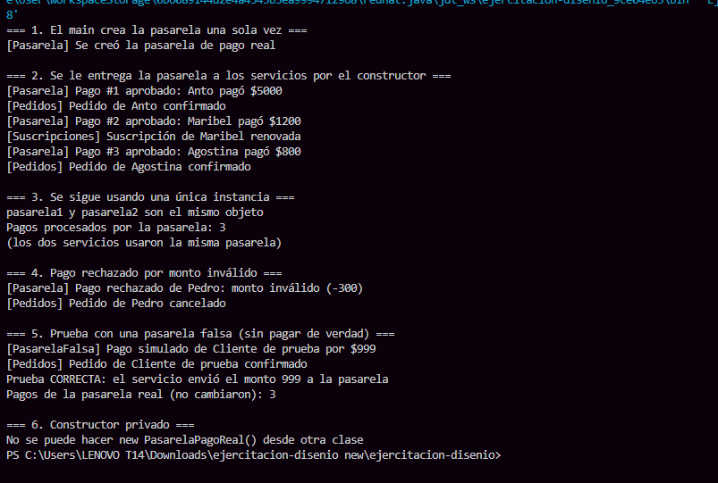

# Unidad 1

| N.º | Ejercicio | Patrón | Estado |
| 01 | [Configuración inicial de la Aplicación]| Singleton | ✅ |
| 02 | _pendiente_ | | ⏳ |
| 03 | _pendiente_ | | ⏳ |
| 04 | _pendiente_ | | ⏳ |
| 05 | _pendiente_ | | ⏳ |
| 06 | _pendiente_ | | ⏳ |
| 07 | _pendiente_ | | ⏳ |
| 08 | _pendiente_ | | ⏳ |
| 09 | _pendiente_ | | ⏳ |
| 10 | _pendiente_ | | ⏳ |

Ejercicio 1: Configuración Inicial de la Aplicación
Problema
Una aplicación modular necesita cargar sus propiedades de configuración desde un archivo maestro cuando arranca. Si cada componente creara su propio lector de configuración:

Se leería el archivo varias veces (se desperdician recursos de entrada/salida).
Podrían quedar valores distintos en memoria según el componente.
Solución: patrón Singleton

La clase ConfigurationManager se restringe para que exista una sola instancia en toda la aplicación, y cualquier parte del programa puede acceder a ella.

¿Que hace el código?
-Carga el archivo de configuración una sola vez.
-Dos componentes (ComponenteBaseDatos y ComponenteCorreo) consultan parámetros sin crear su propio lector.
-Comprueba que dos referencias distintas apuntan al mismo objeto.
-Llama otra vez a cargar() y verifica que se ignora.
-Consulta una clave que no existe, con y sin valor por defecto.
-Crea 10 hilos y comprueba que todos obtienen la misma instancia.
-Recuerda que el constructor privado impide crear objetos desde afuera.

Lo que muestra en consola:

## Bloque B: ejercicios 11 a 20

| N.º | Ejercicio | Patrón | Estado |
|---|---|---|---|
| 11 | _pendiente_ | | ⏳ |
| 12 | _pendiente_ | | ⏳ |
| 13 | _pendiente_ | | ⏳ |
| 14 | _pendiente_ | | ⏳ |
| 15 | _pendiente_ | | ⏳ |
| 16 | _pendiente_ | | ⏳ |
| 17 | _pendiente_ | | ⏳ |
| 18 | _pendiente_ | | ⏳ |
| 19 | _pendiente_ | | ⏳ |
| 20 | _pendiente_ | | ⏳ |

[← Volver al índice general](../README.md)
