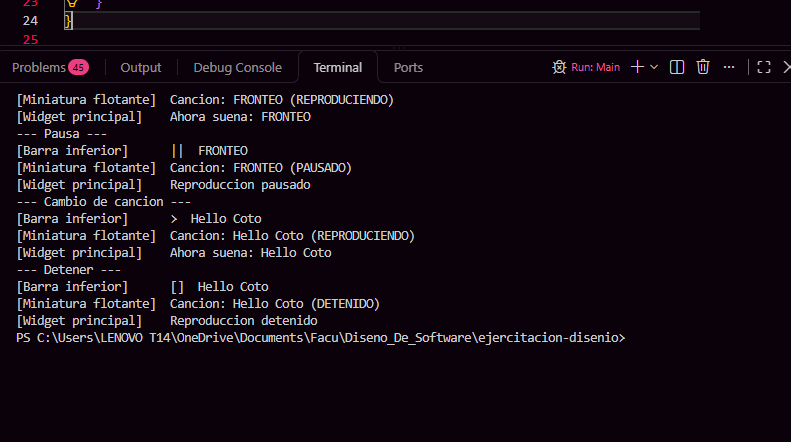
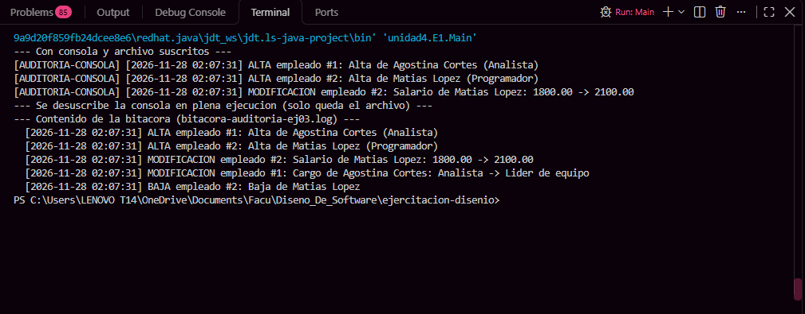

# Unidad 3
 Bloque A: ejercicios 01 a 10

------Ejercicio 1: Estación Meteorológica------
Problema:
Una estación meteorológica registra cambios de temperatura y otros elementos (pantallas, registros) necesitan enterarse de cada cambio. Si la estación tuviera que conocer a cada uno directamente, el código quedaría muy acoplado y sería difícil agregar o quitar elementos.

Solución:
Se usa el patrón Observer (Observador): la clase EstacionMeteorologica avisa automáticamente a todos los observadores registrados cada vez que cambia la temperatura, sin depender de cómo cada uno la usa.

Qué hace el programa
-Crea la estación meteorológica, las pantallas digitales y el registro histórico.
-Registra los observadores en la estación.
-Realiza distintos cambios de temperatura y cada observador recibe la notificación.
-Desvincula una de las pantallas para comprobar que deja de recibir actualizaciones.
-Realiza nuevos cambios de temperatura.
-Imprime el resumen del registro histórico de temperaturas.

Explicación de las clases:
+EstacionMeteorologica: administra la temperatura y se encarga de registrar, quitar y notificar a los observadores.
+ObservadorTemperatura: interfaz que define el método que deben implementar los observadores para recibir los cambios.
+PantallaDigital: implementa la interfaz, muestra la temperatura actual y la ubicación de la pantalla.
+RegistroHistorico: implementa la interfaz, guarda las temperaturas recibidas y muestra un resumen de las lecturas.
+Main: contiene el método principal, crea los objetos y prueba el funcionamiento del programa.

Lo que muestra en consola: 

------Ejercicio 2: Reproductor de Música------
Problema:
Un reproductor de música tiene varias partes de la interfaz (barra de control, ventana miniatura, widget de pantalla principal) que deben mostrar siempre la canción actual y su estado. Si el motor de reproducción tuviera que actualizar cada una directamente, el código quedaría muy acoplado y sería difícil agregar o quitar vistas.

Solución:
Se usa el patrón Observer (Observador): la clase MotorReproduccion guarda la canción y el estado, y avisa automáticamente a todos los observadores suscritos cada vez que algo cambia. Cada vista decide cómo mostrar la información.

Qué hace el programa
-Crea el motor de reproducción y las tres vistas (barra inferior, ventana miniatura y widget de pantalla principal).
-Suscribe los tres observadores al motor.
-Selecciona la canción "Bohemian Rhapsody" y las tres vistas reciben la notificación.
-Cambia el estado a pausado y las vistas se actualizan.
-Cambia a la canción "Hotel California" y las vistas se actualizan.
-Detiene la reproducción y las vistas muestran el nuevo estado.

Explicación de las clases:
+MotorReproduccion: administra la canción actual, el estado de reproducción y la lista de observadores. Envía las notificaciones cuando hay cambios.
+ObservadorReproductor: interfaz que deben implementar las clases que reciben las actualizaciones del reproductor.
+EstadoReproduccion: define los tres estados posibles: reproduciendo, pausado y detenido.
+BarraInferiorControl: muestra la canción actual y un símbolo que representa el estado de reproducción.
+VentanaMiniatura: muestra el nombre de la canción y su estado en una ventana pequeña.
+WidgetPantallaPrincipal: muestra qué canción está sonando o informa si la reproducción está pausada o detenida.
+Main: contiene el método principal, crea el reproductor, suscribe los observadores y realiza los cambios para comprobar su funcionamiento.

Lo que muestra en consola: 

------Ejercicio 3: Sistema de Auditoría de Empleados------
Problema:
Un sistema de empleados realiza operaciones como altas, bajas y modificaciones de salario o cargo, y cada una debe quedar registrada para auditoría. Si el sistema tuviera que encargarse directamente de mostrar y guardar esos registros, el código quedaría muy acoplado y sería difícil agregar o quitar formas de auditar.

Solución:
Se usa el patrón Observer (Observador): la clase SistemaEmpleados avisa automáticamente a todos los auditores suscritos cada vez que se realiza una operación. Cada auditor decide qué hacer con la información: uno la muestra por consola y otro la guarda en un archivo.

Qué hace el programa
-Crea el sistema de empleados y los dos auditores (consola y archivo).
-Suscribe ambos auditores al sistema.
-Da de alta a dos empleados y realiza diferentes operaciones sobre ellos; se muestran en consola y se guardan en el archivo.
-Desuscribe el auditor de consola.
-Realiza nuevas modificaciones y una baja de empleado; ahora solo quedan registradas en el archivo.
-Muestra el contenido del archivo de auditoría con todos los eventos.

Explicación de las clases:
+SistemaEmpleados: administra los empleados, permite realizar altas, bajas y modificaciones, y notifica a los auditores cuando ocurre una operación.
+Empleado: representa a cada empleado y almacena sus datos: ID, nombre, cargo y salario.
+OyenteAuditoria: interfaz que deben implementar las clases que reciben las notificaciones.
+EventoAuditoria: representa la información de cada operación: tipo, empleado involucrado, detalle y fecha y hora.
+OperacionEmpleado: define los tipos de operaciones posibles: alta, baja y modificación.
+AuditorConsola: recibe las notificaciones y muestra los registros de auditoría en la consola.
+AuditorArchivo: recibe las notificaciones y las guarda en un archivo de registro.
+Main: contiene el método principal, crea el sistema, registra los auditores y realiza las operaciones para comprobar su funcionamiento.

Lo que muestra en consola: 

------Ejercicio 4.E1.04: Control de Stock------
Problema:
Un sistema de control de stock necesita avisar a distintos departamentos cuando la cantidad disponible de un producto baja de un mínimo establecido. Si el producto tuviera que conocer y llamar directamente a cada departamento, el código quedaría muy acoplado y sería difícil agregar o quitar departamentos interesados.

Solución:
Se usa el patrón Observer (Observador): la clase Producto avisa automáticamente a los observadores registrados cuando, después de una venta, su stock queda por debajo del umbral mínimo. Cada departamento decide qué hacer con el aviso: Compras calcula cuántas unidades pedir y Marketing ajusta sus campañas.

Qué hace el programa
-Crea dos productos: Notebook y Mouse, cada uno con su stock y su umbral mínimo.
-Registra Compras y Marketing en la Notebook, y solo Compras en el Mouse.
-Realiza ventas que descuentan unidades del stock.
-Cuando el stock queda por debajo del umbral, los observadores reciben la notificación y realizan su acción.
-Prueba qué sucede cuando un producto se agota (Marketing pausa las campañas).
-Intenta vender una cantidad mayor a la disponible.

Explicación de las clases:
+Producto: representa un producto y administra su stock. Registra observadores y les notifica cuando el stock baja del mínimo establecido.
+ObservadorStock: interfaz que deben implementar las clases que quieran recibir notificaciones sobre el stock.
+EventoStockBajo: contiene la información del producto, el stock actual y el umbral mínimo.
+DepartamentoCompras: recibe las notificaciones y calcula cuántas unidades se deben pedir para reponer el stock.
+SistemaMarketing: recibe las notificaciones y muestra un mensaje según la situación del producto; si está agotado, indica que se deben pausar las campañas.
+Main: contiene el método principal, crea los productos, registra los observadores y realiza las ventas para probar el funcionamiento.

Lo que muestra en consola: falta correr

------Ejercicio 5: Sistema de Detección de Humo------
Problema:
En un edificio, varios sensores detectan humo y distintos sistemas (alarma, rociadores, conserjería) deben reaccionar ante cada detección. Si el sensor tuviera que conocer y llamar directamente a cada sistema, el código quedaría muy acoplado y habría que modificarlo cada vez que se agregue un sistema nuevo.

Solución:
Se usa el patrón Observer (Observador): la clase SensorHumo genera una alerta con su ubicación y avisa automáticamente a los observadores registrados. Cada sistema decide qué acción realizar, y se pueden sumar nuevos sistemas, como el control de ascensores, sin modificar el código del sensor.

Qué hace el programa
-Crea tres sensores ubicados en distintos pisos y zonas: Hall, Oficinas y Archivo.
-Registra los observadores en los sensores.
-Simula una detección de humo en el segundo piso; la central de alarmas, los rociadores y la conserjería reciben la notificación.
-Incorpora el control de ascensores como un nuevo observador.
-Simula otra detección en el tercer piso; se activan la central de alarmas, los rociadores y el control de ascensores.

Explicación de las clases:
+SensorHumo: representa un sensor ubicado en una zona del edificio. Detecta humo y notifica a los observadores registrados.
+ObservadorAlarma: interfaz que deben implementar los sistemas que reciben las alertas.
+AlertaHumo: contiene los datos de la alerta: identificador del sensor, piso y zona donde se detectó humo.
+CentralAlarmas: recibe las alertas y activa la sirena indicando la ubicación.
+SistemaRociadores: recibe las alertas y activa los rociadores en la zona correspondiente.
+ServicioConserjeria: recibe las alertas y avisa al personal para que revise el lugar.
+ControlAscensores: nuevo sistema que bloquea los ascensores y los envía a planta baja cuando se detecta humo.
+Main: contiene el método principal, crea los sensores, registra los observadores y simula las detecciones de humo.

Lo que muestra en consola: 

------Ejercicio 5: Sistema de Detección de Humo------
Problema:
En un edificio, varios sensores detectan humo y distintos sistemas (alarma, rociadores, conserjería) deben reaccionar ante cada detección. Si el sensor tuviera que conocer y llamar directamente a cada sistema, el código quedaría muy acoplado y habría que modificarlo cada vez que se agregue un sistema nuevo.

Solución:
Se usa el patrón Observer (Observador): la clase SensorHumo genera una alerta con su ubicación y avisa automáticamente a los observadores registrados. Cada sistema decide qué acción realizar, y se pueden sumar nuevos sistemas, como el control de ascensores, sin modificar el código del sensor.

Qué hace el programa
-Crea tres sensores ubicados en distintos pisos y zonas: Hall, Oficinas y Archivo.
-Registra los observadores en los sensores.
-Simula una detección de humo en el segundo piso; la central de alarmas, los rociadores y la conserjería reciben la notificación.
-Incorpora el control de ascensores como un nuevo observador.
-Simula otra detección en el tercer piso; se activan la central de alarmas, los rociadores y el control de ascensores.

Explicación de las clases:
+SensorHumo: representa un sensor ubicado en una zona del edificio. Detecta humo y notifica a los observadores registrados.
+ObservadorAlarma: interfaz que deben implementar los sistemas que reciben las alertas.
+AlertaHumo: contiene los datos de la alerta: identificador del sensor, piso y zona donde se detectó humo.
+CentralAlarmas: recibe las alertas y activa la sirena indicando la ubicación.
+SistemaRociadores: recibe las alertas y activa los rociadores en la zona correspondiente.
+ServicioConserjeria: recibe las alertas y avisa al personal para que revise el lugar.
+ControlAscensores: nuevo sistema que bloquea los ascensores y los envía a planta baja cuando se detecta humo.
+Main: contiene el método principal, crea los sensores, registra los observadores y simula las detecciones de humo.

Lo que muestra en consola:

## Bloque B: ejercicios 11 a 20

| N.º | Ejercicio | Patrón | Estado |
|---|---|---|---|
| 11 | _pendiente_ | | ⏳ |
| 12 | _pendiente_ | | ⏳ |
| 13 | _pendiente_ | | ⏳ |
| 14 | _pendiente_ | | ⏳ |
| 15 | _pendiente_ | | ⏳ |
| 16 | _pendiente_ | | ⏳ |
| 17 | _pendiente_ | | ⏳ |
| 18 | _pendiente_ | | ⏳ |
| 19 | _pendiente_ | | ⏳ |
| 20 | _pendiente_ | | ⏳ |

[← Volver al índice general](../README.md)
